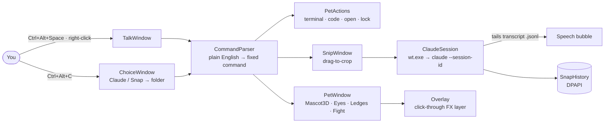

<div align="center">


<br/>


</div>

---

## `> whoami`

**Claude Pet** is the Claude Code mascot, rebuilt as a **real 3D model** (the pixel sprite extruded into bevelled blocks) that lives on your Windows desktop.

It roams, climbs onto your windows, rides them when you drag them, and can do things on your PC when you type plain sentences. Most importantly, it **snaps your screen and hands it to Claude Code**: pick a region, type your question, and a real `claude` session opens in the right folder. The pet relays the replies in its speech bubble.

> 🔒 **Nothing you type is ever run as a shell command.** The parser can only pick one of a fixed set of actions.

---

## `> metrics`

<div align="center">

| ⚡ Signal | 📊 Value |
|:--|:--|
| Commands understood | **36** kinds, parsed from plain English |
| Unit tests | **87 / 87 passing** (xUnit) |
| Global hotkeys | **3** · `Ctrl+Alt+Space` · `Ctrl+Alt+P` · `Ctrl+Alt+C` |
| Eye expressions | **7** · normal · happy · squint · star · dizzy · sleepy · white |
| Fight rounds | **9** incl. thunder finisher: hit-stop, knockback, sparks, screen shake |
| Snap history | encrypted at rest with **Windows DPAPI** |
| Remote Control in snap sessions | **forced off** |

</div>

---

## `> features`

<table>
<tr>
<td width="50%" valign="top">

### 📸 Snap → Claude
`snap in mes3: why is this failing`
- Freezes the screen, dim overlay, **drag to pick** a region
- Opens **Windows Terminal** in the folder running `claude` with your `/lesgo` text + the screenshot
- Follows the session transcript and **speaks the replies**
- Eyes roll up while thinking, dart along lines while Claude reads files
- `snap history`: your past snaps, DPAPI-encrypted

</td>
<td width="50%" valign="top">

### 🪟 Windows as ground
- Window title bars are **ledges**: thrown, it lands on the first one
- Walks along them, **rides** a window you drag
- Falls when the window goes, teeters at the edge
- In full-screen apps it ducks below the screen and **peeks up** when Claude is done

</td>
</tr>
<tr>
<td valign="top">

### 🖥️ PC actions
- `open terminal [in this folder / mes3 / a path]`
- `open vs code [in ...]` · `open antigravity`
- `open folder downloads` · named links
- `take a screenshot` · `snip` · `lock the screen`

</td>
<td valign="top">

### 🎭 Personality
- `wave` `cheer` `dash` `climb` `tour` `sit` `sleep`
- `backflip` `front flip` `spin` `dance` `stretch` `trip`
- `follow me` · `draw` · `summon [20/30]` friends
- `fight`: a dark twin drops in on a lightning bolt
- Blushes under the mouse, then fades so it never blocks you; dozes when you're away

</td>
</tr>
</table>

---

## `> architecture`



---

## `> boot`

**Requirements:** Windows 10/11 · [.NET 9 SDK](https://dotnet.microsoft.com/download) · [Windows Terminal](https://aka.ms/terminal) · [Claude Code](https://docs.claude.com/en/docs/claude-code) logged in (for snaps)

```bash
dotnet run --project ClaudePet       # start the pet
dotnet test                          # 87 tests
```

Settings live in `%APPDATA%\ClaudePet\settings.json`, written with defaults on first run. Add your own **folders, apps and links** there so the pet knows them by name (`open terminal in mes3`).

| Hotkey | Does |
|:--|:--|
| `Ctrl+Alt+Space` | Talk to the pet (or right-click it) |
| `Ctrl+Alt+P` | Hide / show; hidden means nothing animates |
| `Ctrl+Alt+C` | Claude or Snap menu → folder → your text |

---

<div align="center">


<sub>built by <a href="https://github.com/PrathmeshPatil-dev">@PrathmeshPatil-dev</a> · fan-made, not affiliated with Anthropic</sub>

</div>
